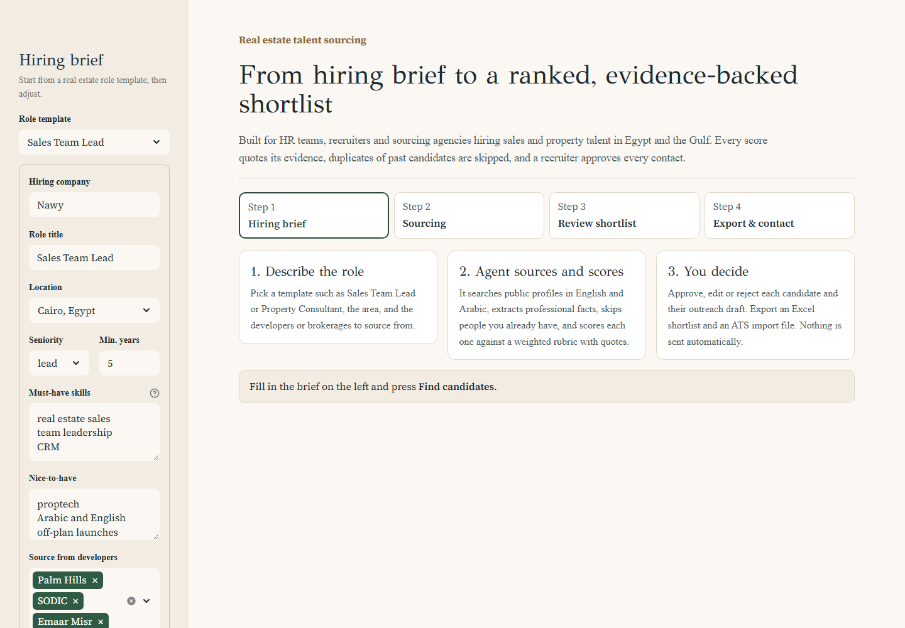
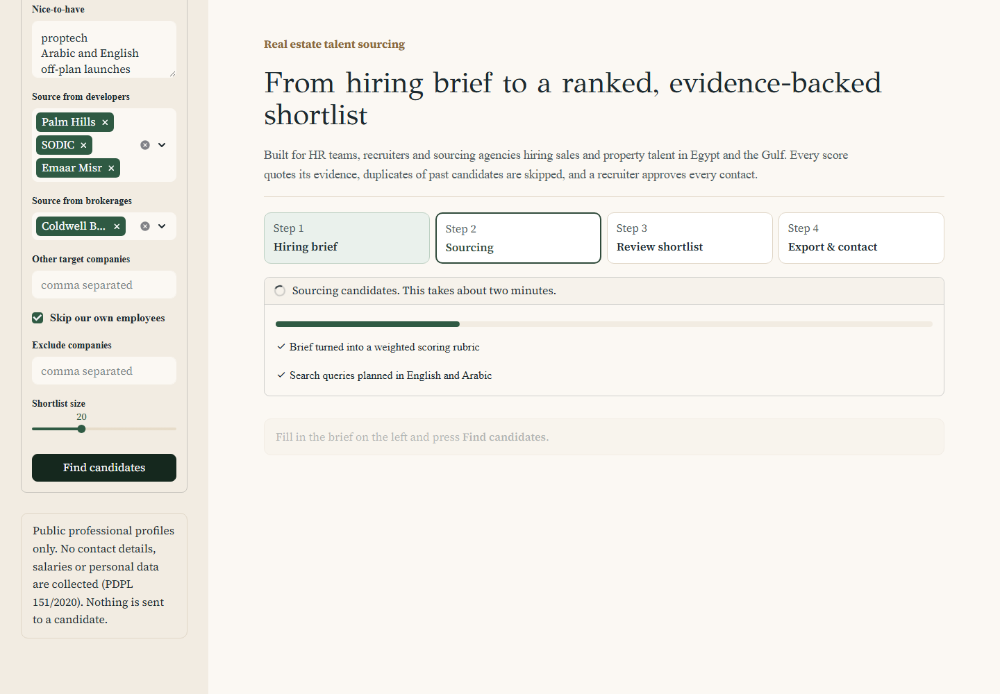
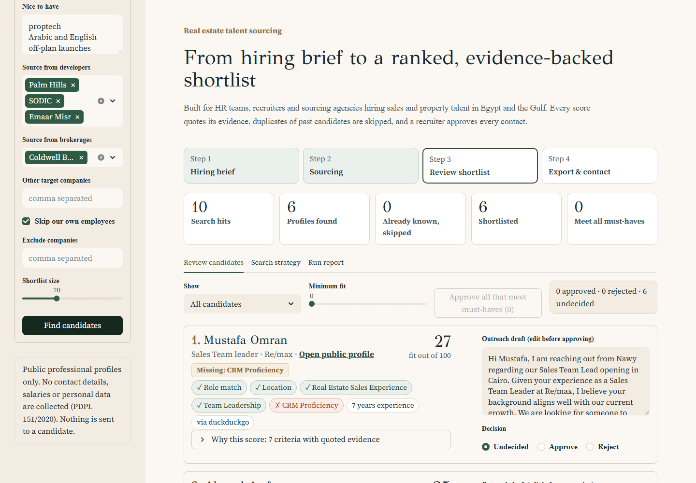
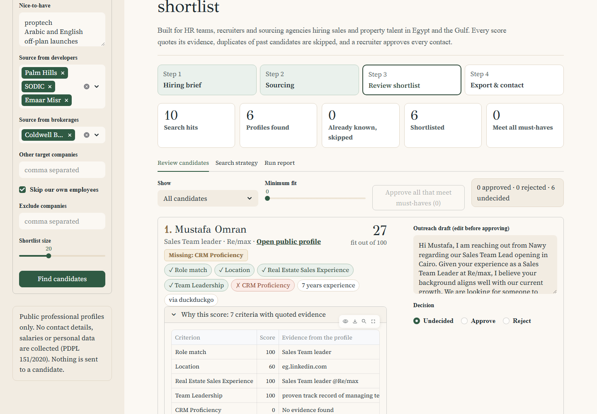
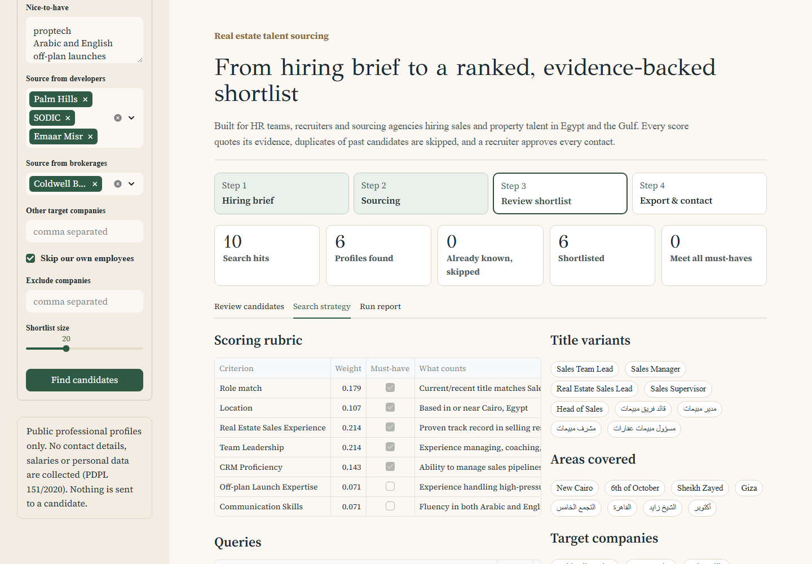
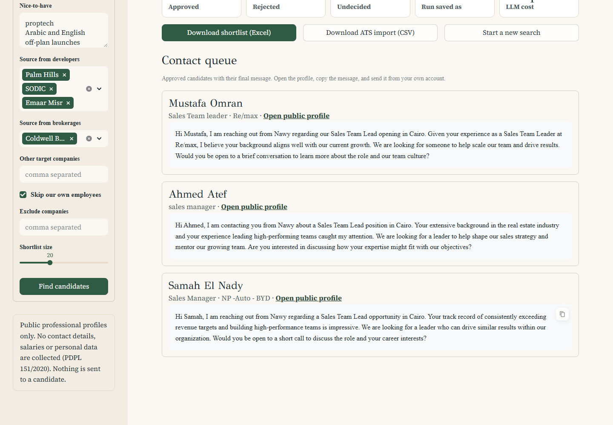
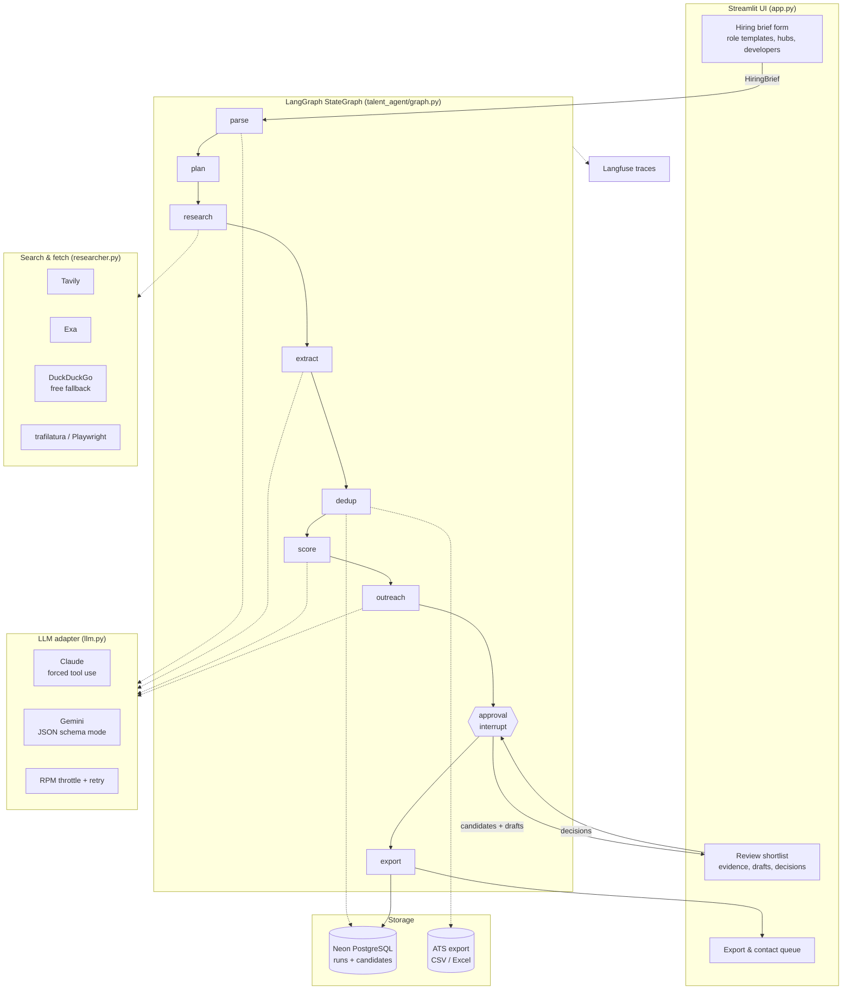
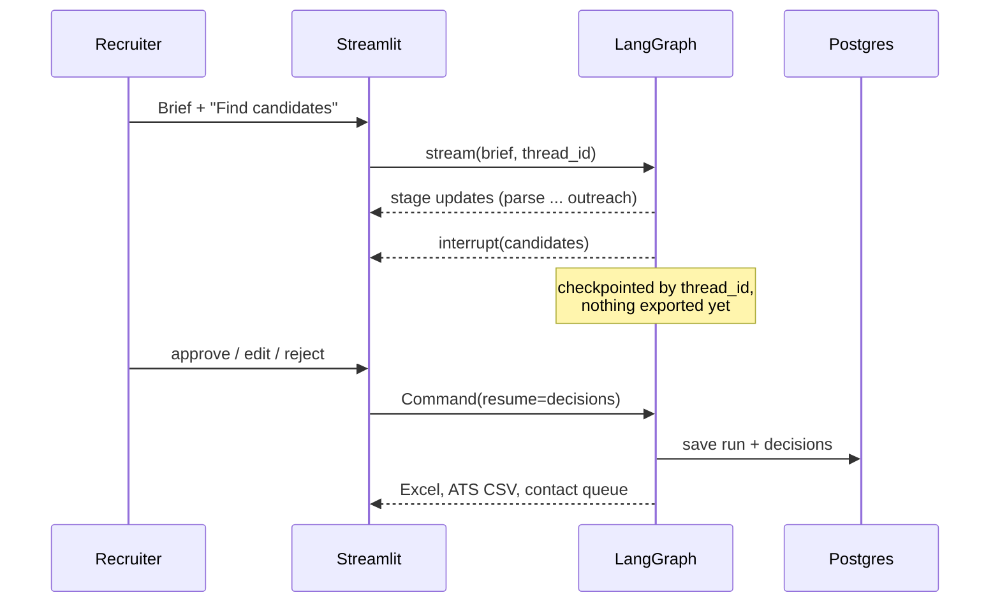

# Talent-Sourcing Agent for Real Estate

An agentic recruiting assistant for HR teams, in-house recruiters and sourcing agencies hiring sales and property talent in Egypt and the Gulf. A hiring manager types a brief such as "Sales Team Lead, Cairo". The agent plans bilingual searches, finds public professional profiles, extracts professional facts only, skips people already in the ATS or earlier runs, and scores every candidate against a weighted rubric with quoted evidence. It then drafts a personalized outreach message for each one. A recruiter approves, edits or rejects every candidate before anything leaves the system.

**Live app:** https://talent-sourcing-agent-using-langgraph-claude-tavily-app-wmyt3y.streamlit.app

[](https://github.com/Mrwanawad/Talent-Sourcing-Agent-using-LangGraph-Claude-Tavily-Streamlit/actions/workflows/ci.yml)

| | |
|---|---|
| Problem | Manual sourcing for one real estate sales role takes recruiters days to weeks: searching, copying profiles into sheets, checking the ATS for duplicates, writing messages one by one. |
| Result | One brief in, a ranked shortlist with evidence, outreach drafts, an Excel file and an ATS import out in about 2 minutes. |
| Human control | LangGraph `interrupt()` pauses the run before export. Nothing is contacted automatically. |
| Privacy | Professional fields only. Emails and phone numbers are scrubbed before any LLM sees the text. No salary, personal-life or contact scraping (Egypt PDPL, Law 151/2020). LinkedIn is never fetched, only search snippets are used. |
| Runs on free tiers | Gemini free tier + DuckDuckGo + Neon free Postgres + Streamlit Community Cloud. Claude, Tavily and Exa plug in by adding a key. |

---

## Contents

1. [Product walkthrough](#product-walkthrough)
2. [System architecture](#system-architecture)
3. [Pipeline stages](#pipeline-stages)
4. [Design patterns](#design-patterns)
5. [Project structure](#project-structure)
6. [Data model](#data-model)
7. [Scoring method](#scoring-method)
8. [Guardrails and compliance](#guardrails-and-compliance)
9. [Evaluation and results](#evaluation-and-results)
10. [Engineering log](#engineering-log)
11. [Run locally](#run-locally)
12. [Configuration](#configuration)
13. [Deployment](#deployment)
14. [Monitoring](#monitoring)
15. [Limitations and roadmap](#limitations-and-roadmap)

---

## Product walkthrough

The UI follows a recruiter's real workflow in four steps: **Hiring brief, Sourcing, Review shortlist, Export & contact**.

### 1. Hiring brief

Role templates built for real estate: Sales Team Lead, Property Consultant, Sales Manager, Sales Director, Leasing / Rental Agent, Real Estate Marketing Manager, After-Sales / Customer Success, Mortgage Advisor. Each template pre-fills seniority, minimum years, must-have and nice-to-have skills. The form also has:

- Egypt and Gulf real estate hubs: Cairo, New Cairo, Sheikh Zayed, 6th of October, New Administrative Capital, North Coast, Alexandria, Dubai, Riyadh.
- Developer and brokerage pickers to source from (Palm Hills, SODIC, Emaar Misr, Mountain View, Ora, Hyde Park, Coldwell Banker, RE/MAX and more).
- "Skip our own employees": the hiring company is excluded so the agent never pitches its own staff.



### 2. Sourcing with live progress

The graph streams each finished stage to the UI, so recruiters see what is happening instead of a spinner.



### 3. Review shortlist

- KPI strip: search hits, profiles found, already-known people skipped, shortlisted, meeting all must-haves.
- Every card shows: fit out of 100, a tier label ("Meets all must-haves", "Missing: CRM Proficiency", "Missing 2 must-haves"), a met/missing chip per must-have, years of experience, source, and a link to the public profile.
- **Why this score** opens the per-criterion table with the quote from the profile behind each score.
- An editable outreach draft and an Undecided / Approve / Reject decision for each candidate.
- Filters (all, meets must-haves, undecided, approved, rejected), a minimum-fit slider, bulk "Approve all that meet must-haves", and a live decision counter.




The **Search strategy** tab shows the rubric with weights and must-haves, every query sent (engine, type, language), English and Arabic title variants, areas covered and target or excluded companies. Recruiters can see exactly how the agent searched.



### 4. Export & contact

Finalizing resumes the paused graph. It saves decisions to Postgres (used for future dedup and score calibration) and builds two files: an Excel shortlist (Shortlist, Search report and Queries sheets) and an ATS import CSV with approved candidates only. The **Contact queue** lists approved candidates with their final message, a copy button and the profile link. The recruiter sends each message from their own account.



---

## System architecture



Human-in-the-loop sequence:



---

## Pipeline stages

| # | Node | Module | What it does | Fallback without keys |
|---|---|---|---|---|
| 1 | `parse` | `brief_parser.py` | LLM turns the brief into `SearchCriteria`: English and Egyptian Arabic title synonyms, location aliases, skills, and a 4-7 criterion weighted rubric. Role and Location are always added as must-haves; weights are normalized. Protected attributes are banned in the prompt. | Rule-based rubric, title swaps (Team Lead / Team Leader / Supervisor, Sales / Business Development), alias table for 9 hubs |
| 2 | `plan` | `query_planner.py` | Up to 12 deduplicated queries: `site:` boolean queries for public profile sites with OR'ed titles and areas, one query per target company, Arabic title queries, semantic queries for Exa, and `-"company"` exclusions | Same (no LLM needed) |
| 3 | `research` | `researcher.py` | Tavily, Exa (LinkedIn-profile category), or DuckDuckGo. Results deduplicated by normalized URL. Login and authwall URLs dropped. Non-LinkedIn pages with thin text are read with trafilatura, then Playwright | DuckDuckGo |
| 4 | `extract` | `extractor.py` | PII scrubbed, then up to 10 pages per LLM call return professional fields only. Job ads and company pages are rejected (`is_profile=false`). Exclusions applied after extraction | Title parser for `Name - Title - Company`, `Title at Company`, truncated titles; city dictionary; job-ad filter |
| 5 | `dedup` | `dedup.py` | rapidfuzz match against the ATS export and every candidate from earlier runs: exact normalized URL, or name `token_sort_ratio >= 90` with company `partial_ratio >= 80`. Also deduplicates within the run | Same |
| 6 | `score` | `scoring.py` | LLM-as-judge, 6 candidates per call, scores each rubric criterion 0-1 with a verbatim quote. Quotes not found in the source are halved and marked `[unverified]`. Role and Location are also rule-scored and the higher score is kept. Optional bge-m3 similarity, a failed must-have halves the score, optional logistic calibrator | Keyword judge: fuzzy title match, area aliases + LinkedIn country subdomain, years vs minimum, multi-word skill match |
| 7 | `outreach` | `outreach.py` | Under 90 words, one specific achievement, no hype or salary claims, ends with a low-pressure question. 8 candidates per call | Template using the candidate's top achievement or current role |
| 8 | `approval` | `graph.py` | `interrupt()` with candidates. Resume payload `{profile_url: {status, draft}}`. An edited draft sets status `edited` | Same |
| 9 | `export` | `export.py`, `storage.py` | Saves run + candidates, builds Excel and ATS CSV, records per-run token cost, flushes Langfuse | Same |

---

## Design patterns

| Pattern | Where | Why |
|---|---|---|
| **Pipeline as a state machine** | `graph.py` `StateGraph` with typed `State` | Each stage is a pure function `State -> partial update`. Stages are testable alone and the order is explicit in one place |
| **Human-in-the-loop checkpoint** | `interrupt()` + `MemorySaver` keyed by `thread_id`, `Command(resume=...)` | The run truly pauses between scoring and export. Recruiter decisions are the only path to the ATS file |
| **Adapter / Strategy (LLM)** | `llm.py` `LLM` with `provider()`: Claude forced tool use or Gemini JSON-schema mode behind the same `structured()` / `text()` interface | Callers never know which model runs. Switching provider is an env var |
| **Strategy (search engines)** | `researcher.search` routes each `SearchQuery` by `engine` / `kind` to Tavily, Exa or DuckDuckGo | Paid engines when available, free fallback otherwise, same `SearchHit` output |
| **Graceful degradation chain** | Every LLM stage: LLM, then rules (`_rule_based`, `_heuristic`, `_keyword_judge`, `template`) | A missing key, quota error or bad JSON never kills a run. The whole app works with zero keys |
| **Schema-first structured output** | Pydantic models in `models.py`; `Extraction`, `JudgeBatch`, `DraftBatch` as LLM contracts | The LLM's output shape is validated, not parsed by hand. The same models serialize to the checkpoint, DB and UI |
| **Batching with index mapping** | `extractor.batched`, `scoring._judge_batch`, `outreach._batch` | About 10 calls per run instead of about 100. Items carry an `[index]`, so a partly wrong batch still maps correctly and missing items fall back alone |
| **Rate limiter (shared slot scheduler)** | `llm.Throttle` | Evenly spaces calls across threads under `GEMINI_RPM`, plus retry with the server's "retry in Xs" hint for 429/503/timeouts |
| **Guard / verification step** | `scoring._ground` | Hallucination check: evidence must exist in the source text or the score is halved |
| **Decorator (optional observability)** | `observability.observe` | Langfuse tracing when keys exist, a zero-cost no-op otherwise; no `if langfuse:` checks in business code |
| **12-factor configuration** | `config.Settings` (pydantic-settings) + Streamlit secrets bridge | One typed settings object from `.env`, env vars or Streamlit Cloud secrets |
| **Repository-style persistence** | `storage.py` (`save_run`, `previous_candidates`, `decisions`) on SQLAlchemy | SQLite locally, Postgres in production, same code. Feeds dedup memory and calibration |
| **Privacy by design** | `extractor.scrub` before the LLM; `Profile.raw_text` excluded from serialization; LinkedIn never fetched | Personal data never reaches the model or the exports |
| **Generator streaming** | `graph.stream_stages` yields finished node names | The UI shows live progress without knowing graph internals |

---

## Project structure

```
talent-sourcing-agent/
├── app.py                      Streamlit UI: brief form, live stages, review, export, contact queue
├── run_cli.py                  Headless run: brief JSON in, Excel + ATS CSV out
├── talent_agent/
│   ├── graph.py                LangGraph StateGraph, approval interrupt, start/resume/stream helpers
│   ├── models.py               Pydantic schemas shared by every stage (brief, criteria, hit, profile, scores, report)
│   ├── config.py               Typed settings from .env / env vars / Streamlit secrets
│   ├── llm.py                  Claude + Gemini adapter, structured output, cost meter, throttle, retries
│   ├── brief_parser.py         Brief -> criteria + weighted rubric; enforces Role + Location; location aliases
│   ├── query_planner.py        Boolean (site:, EN/AR) and semantic queries, exclusions
│   ├── researcher.py           Tavily / Exa / DuckDuckGo search, URL dedup, trafilatura + Playwright fetch
│   ├── extractor.py            PII scrub, batched LLM extraction, title parser, job-ad filter, batching helper
│   ├── dedup.py                rapidfuzz matching vs ATS file and previous runs
│   ├── scoring.py              Batched LLM judge, evidence grounding, keyword judge, weighting, calibration
│   ├── outreach.py             Batched outreach drafts with template fallback
│   ├── export.py               Excel (3 sheets) and ATS CSV builders
│   ├── storage.py              SQLAlchemy models and queries (runs, candidates, decisions)
│   ├── observability.py        Optional Langfuse decorator and flush
│   └── presets.py              Real estate role templates, hubs, developers, brokerages
├── evals/
│   ├── run_evals.py            extraction accuracy, ranking metrics, calibrator fitting
│   └── data/                   labeled_profiles.jsonl (10 incl. a job-ad negative), decisions.csv (12)
├── tests/test_pipeline.py      15 offline tests, including the full graph with interrupt/resume
├── examples/sales_team_lead_cairo.json
├── docs/screenshots/           UI screenshots used in this README
├── .streamlit/                 theme (config.toml) and secrets template
├── .github/workflows/ci.yml    ruff, format check, pytest, extraction eval
├── architecture.md             original design brief
├── CHECKPOINT.md               project state and history
├── requirements.txt            runtime (cloud-light, no torch)
└── requirements-embeddings.txt adds sentence-transformers for local bge-m3
```

About 2,500 lines of Python. Each module owns one stage, all stages share one schema module, and every external dependency (LLM, search, DB, tracing) sits behind its own small module.

---

## Data model

```
HiringBrief ──parse──> SearchCriteria (+ rubric: list[Criterion{name, weight, must_have}])
                          │
                       plan ──> list[SearchQuery{text, kind, engine, language}]
                          │
                   research ──> list[SearchHit{url, title, snippet, content, source}]
                          │
                    extract ──> list[Profile{name, title, company, city, years, skills, achievements}]
                          │
                 dedup/score ──> list[ScoredCandidate{profile, criteria[CriterionScore{score, evidence}],
                                                     judge_score, embedding_similarity, fit_score,
                                                     outreach_draft, status}]
                          │
                    export ──> SearchReport{hits, sources, fetch_failures, duplicates, cost} + Excel + CSV
```

Postgres tables: `runs(id, created_at, brief JSON, report JSON)` and `candidates(id, run_id, name, company, profile_url, fit_score, status, payload)`.

---

## Scoring method

For a candidate with criterion scores `s_i` and rubric weights `w_i` (normalized to sum to 1):

```
judge     = Σ w_i · s_i                      × 0.5 if any must-have scores < 0.3
fit       = 0.3 · similarity + 0.7 · judge   (or a fitted logistic calibrator on [similarity, judge])
```

- `s_i` comes from the LLM judge with a verbatim quote. A quote that is not in the source text is halved.
- Role and Location take `max(LLM, rule)`. The rules are a fuzzy title match against all synonyms, area aliases in the text, and the LinkedIn country subdomain (`eg.linkedin.com`, scored 0.6). Snippets often hide what the URL and title show.
- `similarity` is bge-m3 cosine when `USE_EMBEDDINGS=true`, otherwise token overlap.
- `python -m evals.run_evals calibrate` fits `LogisticRegression` on manager approve/reject decisions stored in Postgres, so the score learns what this team accepts.

The UI shows fit as 0-100. The tier label depends on must-haves: all met, one missing (named), or several missing.

---

## Guardrails and compliance

- **Data minimization:** `Profile` holds professional fields only. Regex scrub of emails and Egyptian or international phone numbers runs before any LLM call. `raw_text` is excluded from every serialization.
- **No logged-in scraping:** LinkedIn is used through search snippets only; login and authwall URLs are dropped. Official or recruiter APIs are the path where terms require it.
- **Fairness:** the brief parser and judge prompts forbid age, gender, religion, nationality, marital status, health and appearance as criteria or signals. Years of experience is allowed as a professional range.
- **Human approval:** export happens only after `interrupt()` is resumed with decisions. The ATS CSV contains approved or edited candidates only. Nothing is sent.
- **HTML safety:** scraped titles and names are HTML-escaped in the UI, and profile links are allowed only for `http(s)`.
- **Own-staff protection:** the hiring company is excluded by default.

---

## Evaluation and results

| Check | Result |
|---|---|
| `pytest -q` | 15 passed, offline (no keys, no network). Covers rubric weights, queries, PII scrub, title parsing, job-ad rejection, dedup (URL and fuzzy), ATS loading, ranking, must-have halving, evidence grounding, exports, DuckDuckGo routing, provider selection, batch index mapping with fallback, and the full graph with interrupt and resume |
| `ruff check .` + `ruff format --check .` | clean |
| CI (GitHub Actions) | green on every push |
| Extraction eval, rule fallback | name 1.0, title 1.0, company 1.0, city 1.0 on 10 labeled pages (synthetic) |
| Ranking eval (sample decisions) | acceptance rate 0.5, precision@10 0.6 |
| Live run (Gemini + DuckDuckGo + Neon) | ~18 search hits, 11-17 profiles, about 2 minutes, about 10 LLM calls. Top results are Egypt real estate sales leads (Coldwell Banker Egypt, Emaar Misr, G Developments); Gulf and other-country profiles rank lower |
| First cloud run | 17 hits, 10 profiles, 2 duplicates removed against Neon, 8 shortlisted |

---

## Engineering log

Problems solved along the way, and how:

1. **Free search without paid keys.** Added a DuckDuckGo strategy. Boolean queries are routed to it and semantic queries are skipped, since they need Exa. A keyless run went from 0 results to 14-20 real public profiles.
2. **LinkedIn fetches always failed (15/15).** LinkedIn pages are now never fetched; snippets only. This is faster and respects platform terms. Fetch failures dropped to 0.
3. **Messy search titles.** The parser handles `...` truncation, `Title at Company`, `|` separators, and rejects job ads such as "Sales Team Leader job in Cairo". City detection uses a hub dictionary. Extraction eval reached 1.0 on all fields.
4. **Order-dependent scoring bug.** `weighted()` used to stop at the first failed must-have, dropping later criteria. Now the full sum is halved, so rubric order doesn't matter.
5. **Rate limits on the Gemini free tier.** About 100 calls per run hit 15 RPM: 429s and 6 minutes. Batched extraction (10/call), judging (6/call) and outreach (8/call) with index mapping, plus a shared throttle and hint-aware retry. Now about 10 calls, about 2 minutes, no 429s.
6. **LLM rubric forgot location.** An Oman profile ranked #1 for a Cairo role. Role and Location are now always enforced as must-haves and also rule-scored, using the LinkedIn country subdomain as a weak signal. The top results became Cairo real estate leads.
7. **Cost accounting across sessions.** The meter is process-wide on Streamlit. Each run now records its starting cost, so the reported cost covers that run only. Models without a known price show "not priced" instead of $0.
8. **Langfuse keys in `.env` were ignored.** Settings now export them to the SDK.
9. **Cloud-sized dependencies.** torch and bge-m3 (about 2.2 GB) moved to `requirements-embeddings.txt`, so the Streamlit Cloud build stays light.
10. **Windows console crash on Arabic and Cyrillic names.** The CLI forces UTF-8 stdout.

---

## Run locally

```bash
pip install -r requirements.txt            # or requirements-embeddings.txt for bge-m3
playwright install chromium                # optional, for JS-heavy public pages
cp .env.example .env                       # add GEMINI_API_KEY (or ANTHROPIC_API_KEY)
streamlit run app.py

# headless
python run_cli.py examples/sales_team_lead_cairo.json --company Nawy --out out

# quality
pytest -q
ruff check . && ruff format --check .
python -m evals.run_evals extraction
python -m evals.run_evals ranking
python -m evals.run_evals calibrate       # needs approve/reject decisions in the DB
```

With no keys at all, every stage falls back to rules and DuckDuckGo, so the full flow still runs.

---

## Configuration

| Variable | Default | Purpose |
|---|---|---|
| `LLM_PROVIDER` | `auto` | `auto` uses Claude if its key is set, else Gemini, else rules. Or force `anthropic` / `gemini` |
| `GEMINI_API_KEY`, `GEMINI_MODEL`, `GEMINI_FAST_MODEL` | `gemini-3.1-flash-lite` | Gemini models (fast model used for extraction) |
| `GEMINI_RPM` | `14` | Throttle for the free-tier 15 requests/min |
| `ANTHROPIC_API_KEY`, `CLAUDE_MODEL`, `CLAUDE_FAST_MODEL` | `claude-sonnet-5-5`, `claude-haiku-5-5` | Claude models |
| `LLM_PRICE_IN`, `LLM_PRICE_OUT` | `0` | USD per 1M tokens for models not in the built-in price table |
| `TAVILY_API_KEY`, `EXA_API_KEY` | empty | Paid search; preferred over DuckDuckGo when set |
| `USE_DDG` | `true` | Free DuckDuckGo search when no Tavily key |
| `USE_EMBEDDINGS`, `EMBEDDING_MODEL` | `false`, `BAAI/bge-m3` | Brief-to-profile similarity (needs `requirements-embeddings.txt`) |
| `USE_PLAYWRIGHT` | `true` locally | Browser fallback for public pages with little static text |
| `DATABASE_URL` | `sqlite:///talent_agent.db` | `postgresql+psycopg://...` in production (Neon) |
| `ATS_CSV_PATH` | empty | Existing ATS export (CSV/Excel) to dedup against |
| `MAX_PAGES` | `40` | Cap on pages extracted per run |
| `LANGFUSE_PUBLIC_KEY`, `LANGFUSE_SECRET_KEY`, `LANGFUSE_HOST` | empty | Tracing |

---

## Deployment

Streamlit Community Cloud + Neon Postgres:

1. share.streamlit.io: Create app, pick this repo, branch `main`, file `app.py`, Python 3.12.
2. Paste `.streamlit/secrets.toml.example` into Secrets with real values (`GEMINI_API_KEY`, `DATABASE_URL`, `USE_EMBEDDINGS="false"`, `USE_PLAYWRIGHT="false"`).
3. The theme comes from `.streamlit/config.toml`.

The hosted Postgres keeps dedup memory and manager decisions across restarts and users.

---

## Monitoring

- Per-run `SearchReport` (hits, sources, pages read, failures, duplicates, shortlisted, token cost) is stored in `runs.report`, the Excel "Search report" sheet and the UI "Run report" tab.
- Langfuse traces `talent_sourcing.run`, `research.search`, `research.fetch`, `score` and every LLM call when keys are set.
- Drift: re-run `calibrate` on new decisions and compare score distribution against acceptance.

---

## Limitations and roadmap

- Snippet-only LinkedIn data is thin, so skill criteria such as "CRM" are often unevidenced and scores are relative rather than absolute. Next: an official or recruiter API source, and Tavily or Exa for richer page text.
- Gemini free tier is shared across concurrent users (15 RPM). A paid key or Claude removes the bottleneck.
- Eval data is synthetic. Next: label 50 real profiles and log manager decisions from real runs, then calibrate.
- Next: Arabic-first outreach option, ATS-specific CSV mappings (Workable, Zoho Recruit, Bayt), and a scheduled re-run per open role with "new since last run" alerts.
